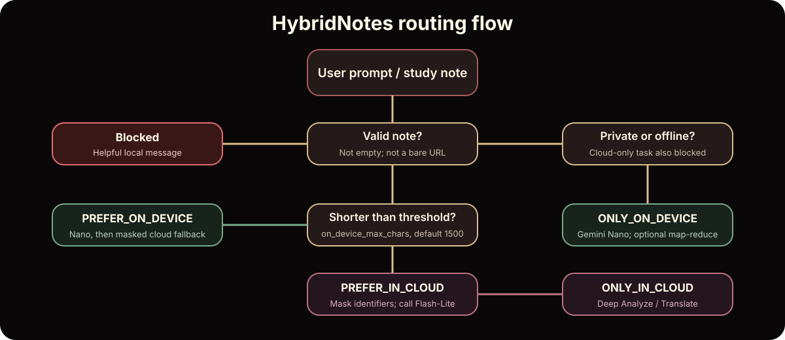
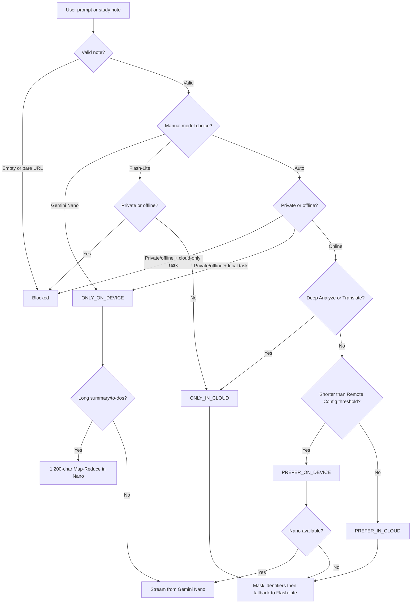

# HybridNotes

A **private-by-default, installable PWA** for AI study notes that routes prompts between **Chrome Built-in AI (Gemini Nano)** and **Gemini 3.5 Flash-Lite** through **Firebase AI Logic**. HybridNotes explains each routing decision, masks common sensitive identifiers before supported cloud requests, and stores chats, profile settings, and routing telemetry locally in `localStorage`.

## What works

- **Automatic and manual routing**: Auto mode considers task type, note length, Private mode, offline state, and the Firebase Remote Config threshold. You can also force **Gemini Nano** or **Gemini 3.5 Flash-Lite** from the model menu.
- **On-device desktop AI**: Uses Chrome's Prompt API (`LanguageModel`) for streaming Nano responses. Desktop users can opt in to the model download from the interface.
- **Cloud fallback**: Preferring Nano does not block the request if Nano is unavailable or fails; compatible requests can fall back to cloud Flash-Lite.
- **Private and offline locks**: Private mode and the offline toggle prevent cloud use. Cloud-only tasks such as Deep Analyze and Translate are refused in those modes.
- **Identifier masking**: Locally masks email addresses, recognizable phone numbers, and numeric sequences of six or more digits before a cloud request. The result shows a per-response masking summary.
- **Long-note local processing**: Long Private or offline summaries and to-do extraction are split into 1,200-character chunks and processed one chunk at a time on-device.
- **Interactive Quiz Me**: Parses generated multiple-choice questions, provides A-D answer controls, grading, explanations, and stores the resulting quiz scores in local statistics.
- **Local history and backup**: Notes, title, profile, tour state, and statistics persist in browser `localStorage`. Profile settings offer JSON export and a clear-data action.
- **Installable PWA**: Includes a web app manifest, icons, and a service worker cache for the app shell. Firebase Hosting deployment rewrites app routes to `index.html`.
- **Routing observability**: Displays the selected route, source, latency, privacy summary, and per-run reason; Profile and Stats views show on-device/cloud usage and avoided cloud calls.

## Routing map

The routing engine uses the actual task, note length, privacy mode, connectivity mode, and `on_device_max_chars` threshold.





## Route behavior

| Mode | Behavior |
| --- | --- |
| `ONLY_ON_DEVICE` | Uses Nano only. Used in Private/offline mode or when Nano is manually selected. |
| `PREFER_ON_DEVICE` | Uses Nano for short supported tasks, with a masked cloud fallback if Nano is unavailable or generation fails. |
| `PREFER_IN_CLOUD` | Prefers Flash-Lite for longer supported tasks. |
| `ONLY_IN_CLOUD` | Uses Flash-Lite for Deep Analyze or Translate. |

Thresholds are fetched from Firebase Remote Config with a default of 1,500 characters. Long summaries and to-do extraction use 1,200-character chunks only in the strict on-device path.

## Privacy and limitations

- Privacy mode and offline routing are application-level restrictions, not a guarantee that browser or network software has no telemetry.
- Redaction is pattern-based and can miss names, addresses, alphanumeric IDs, or identifiers with unusual formats. It is not formal data-loss prevention.
- `localStorage` is local to one browser profile and origin. It is not encrypted by HybridNotes, is not cross-device synced, and can be removed when browser data is cleared.
- Nano availability depends on the browser, device, hardware support, model download state, and Chrome feature rollout. Mobile is treated as unavailable in the current implementation.
- The PWA can cache the app shell, but remote Firebase responses require connectivity unless Nano is available.
- The identifier-masking regex runs in JavaScript on the client before the cloud request; it is best-effort, not a substitute for a secure backend policy.

## Project Structure

- `index.html` — Landing page, workspace UI, guided demo, profile, and telemetry dialogs
- `src/ai.js` — Firebase setup, App Check, Remote Config, Nano Prompt API streaming, masking, and cloud execution
- `src/router.js` — Pure routing decision engine
- `src/main.js` — Chat state, intent detection, prompts, Quiz Me parsing, JSON export, and statistics
- `src/style.css` — Responsive PWA styling
- `public/sw.js` — Service worker for app-shell caching
- `public/manifest.webmanifest` and `public/icon.svg` — PWA metadata and icon
- `firebase.json` — Firebase Hosting configuration
- `.env.example` — Required browser environment variables

## Local Setup & Testing

### Prerequisites

- Node.js and npm
- A Firebase project with Firebase AI Logic configured
- A reCAPTCHA Enterprise site key if App Check is enabled
- Desktop Chrome for Gemini Nano when testing on-device AI

1. Install dependencies:
   ```bash
   npm install
   ```
2. Copy `.env.example` to `.env` and provide your Firebase values:
   ```env
   VITE_FIREBASE_API_KEY=your_firebase_api_key_here
   VITE_RECAPTCHA_SITE_KEY=your_recaptcha_site_key_here
   ```
3. Start the development server:
   ```bash
   npm run dev
   ```
4. Build the production bundle:
   ```bash
   npm run build
   npm run preview
   ```
5. Deploy:
   ```bash
   firebase deploy --only hosting
   ```

The app currently has no dedicated automated test script or `tests/` directory. Routing and masking should be smoke-tested in the browser: run Private/offline requests, short and long notes, Deep Analyze, Translate, and JSON export.

## Firebase configuration

- Firebase web configuration is initialized in `src/ai.js`.
- `on_device_max_chars` is read from Firebase Remote Config and defaults to `1500`.
- App Check debug mode is enabled only by Vite's development mode.
- Cloud model: `gemini-3.5-flash-lite`.

## License

Licensed under the [Apache License 2.0](./license.md).
